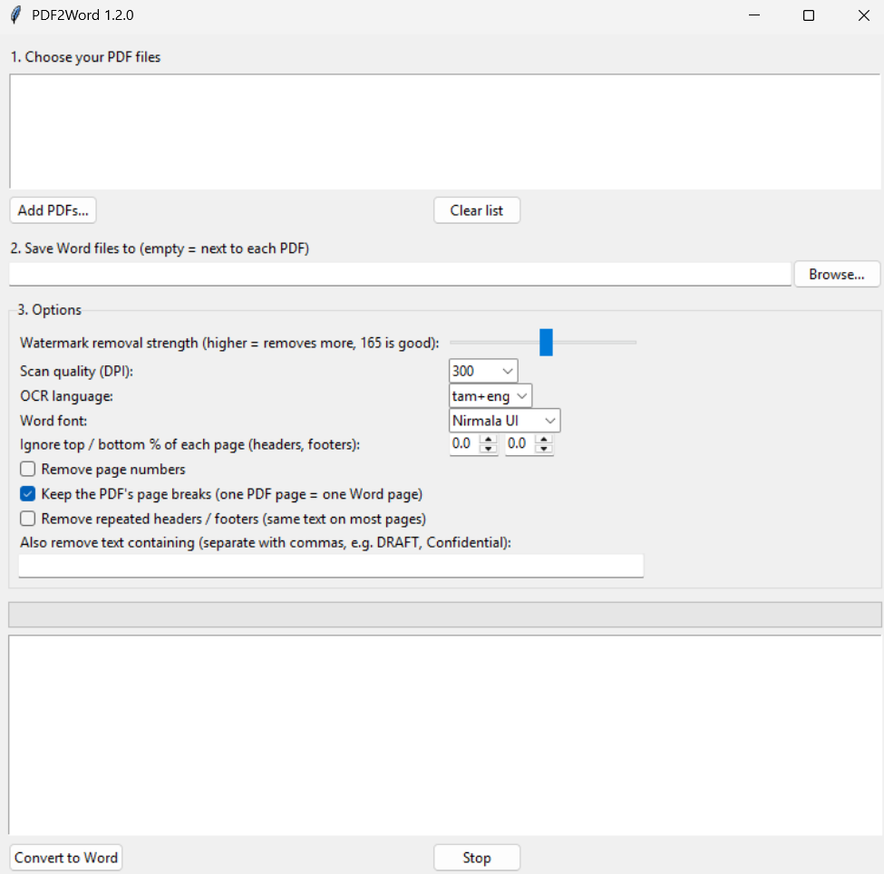

# PDF2Word

**Convert PDFs into editable Word documents with real, copy-paste-friendly Tamil text.**

PDF2Word reads each page with [Tesseract OCR](https://github.com/tesseract-ocr/tesseract), removes faint
watermarks behind the text, keeps pictures and diagrams where they belong, and saves a clean `.docx`.
Everything runs on your own computer; your files are never uploaded anywhere.

<p align="center">
  
</p>

## Why this exists

Many Tamil PDFs are typed with old, non-Unicode fonts. The letters look right on screen, but copying them
gives garbled characters or `????`, even if Tamil is installed on your PC. PDF2Word ignores that broken hidden
text and reads the *picture* of the page instead, so the Word file contains proper Unicode Tamil.

## Features

- **Tamil + English OCR** using Tesseract's high-accuracy `tessdata_best` models
- **Watermark removal**: faint logos or stamps behind the text are filtered out
- **Keeps illustrations**: photos, diagrams and example pictures stay in their original place, in reading order
- **Contents-page cleanup**: dotted leaders (`.........`) no longer turn into junk characters
- **Keeps the original formatting**: font sizes, bold, italic, text colour, centred / justified / right alignment,
  first-line indents, paragraph spacing, line spacing and bullet points are read from the PDF and rebuilt in Word
  (bullets become real Word bullets)
- **Matches text width**: the Word font size is calibrated so lines wrap where they did in the PDF
- **Same page layout**: Word page size and margins follow the PDF, and each PDF page starts a new Word page
- **Clean Word output**: real Unicode text in a Tamil font that Windows includes (Nirmala UI, Latha or Vijaya)
- **Batch conversion**: add many PDFs at once; each becomes its own `.docx`
- **Header, footer and watermark-text removal** (all optional):
  - *Remove repeated headers / footers*: finds lines that repeat in the top or bottom band of most pages
    (running titles, site names, page numbers) and drops them
  - *Remove text containing...*: type words or phrases (for example `DRAFT, Confidential, www.example.com`);
    any line containing them is removed, and matching text is blanked out before OCR
  - *Ignore top / bottom %*: cut a fixed strip off every page
  - *Remove page numbers*
- **Other options**: watermark strength, scan quality (200 / 300 / 400 DPI), Word font, keep or drop the PDF's page breaks
- **Works on scanned PDFs** as well as PDFs with a text layer
- **Automatic setup**: downloads the OCR engine and language data by itself on first run
- **Portable**: a single `.exe`, no installer for the app itself

## Download and use

1. Download `PDF2Word.exe` from the [Releases](../../releases) page and put it in any folder.
2. Run it. On the first conversion it asks permission to download the OCR engine and language data
   (about 40 MB, one time). Windows may show a permission prompt for the engine installer.
3. Click **Add PDFs...**, optionally choose an output folder, then click **Convert to Word**.

Windows SmartScreen may warn about an unrecognised app, because the `.exe` is not code-signed.
Choose *More info → Run anyway*, or build it yourself from source (below).

### Tips

- If faint watermark marks remain, raise **Watermark removal strength**. If thin letters break up, lower it.
- Use **400 DPI** for small print.
- OCR is never perfect on Tamil. Proofread the result once.

### Command line

```
PDF2Word.exe file1.pdf file2.pdf -o OutputFolder
```
Options: `--lang tam+eng`, `--dpi 300`, `--threshold 165`, `--font "Nirmala UI"`, `--ignore-top 5`, `--ignore-bottom 6`,
`--remove-repeated`, `--remove-text "DRAFT, Confidential"`, `--drop-page-numbers`, `--no-page-breaks`.

## Build from source

Requires Windows and Python 3.10+.

```
git clone <this repository>
cd <repository folder>
build.bat
```
The result is `dist\PDF2Word.exe`. To run without building: `pip install -r requirements.txt` then `python pdf2word.py`.

Pushing a tag such as `v1.0.0` makes GitHub Actions build the `.exe` and attach it to a release automatically
(see `.github/workflows/release.yml`).

## How it works

1. Each page is rendered to an image; light pixels (the watermark) are pushed to white, dark text is kept.
2. Pictures and drawings are located in the PDF, copied out in full colour, and blanked from the OCR image.
3. Tesseract reads the cleaned page into words with positions.
4. The PDF's hidden text layer (even when its Tamil letters are scrambled) still holds each word's size, weight, colour
   and position, so formatting is taken from there. Scanned PDFs have no such layer; sizes are estimated and bold is
   detected from stroke thickness.
5. Lines are grouped into paragraphs (alignment, indents, spacing, bullets) and written to a `.docx` together with
   the pictures, in reading order.

## Limitations

- OCR accuracy depends on scan quality; Tamil is harder than English. Expect to proofread.
- The result is a close match, not a pixel-exact copy. Word re-flows text with a different font, so a line can wrap
  slightly differently. Tables, multi-column pages, underlines, text boxes and exact fonts are not reproduced.
- On scanned PDFs, pictures inside the scan are treated as part of the page and are not extracted.
- The automatic engine download is Windows-only. On Linux/macOS install Tesseract with your package manager
  and run `python pdf2word.py`.

## License

[GNU AGPL v3.0](LICENSE). PDF2Word uses PyMuPDF, which is AGPL-licensed, so this project is too.
Third-party components and their licenses are listed in [THIRD_PARTY_NOTICES.md](THIRD_PARTY_NOTICES.md).
